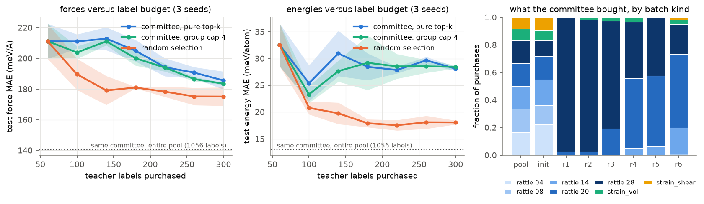

# forcefield-active-learning

[](https://github.com/aamirmalik-dr/forcefield-active-learning/actions/workflows/ci.yml)

A machine-learned interatomic potential is only as good as its training set,
and every training label costs a reference calculation. This project asks
the question that decides whether active learning belongs in a potential
development pipeline: **at a fixed labeling budget, does query-by-committee
buy measurably more accuracy than random selection, and can you trust the
uncertainty signal that drives it?**

The testbed is BCC Ti-Zr-Nb solid solutions. A deep ensemble of five
compact from-scratch potentials explores a fixed pool of rattled and
strained supercells; each round it ranks candidates by committee force
disagreement, sends the most contested structures to the teacher for
labels, retrains, and repeats. The baseline buys labels uniformly at random
from the same pool, on the same schedule, with the same ensemble and
training settings, from the same initial draw.

The measured answer is not the one active-learning papers usually lead
with, and that is the point of this note: **on a well-mixed candidate pool,
random selection beat query-by-committee at every budget past the shared
initial draw**, by 6 percent on
forces and 56 percent on energies at 300 labels, even though the committee's
uncertainty signal ranks actual error almost perfectly (Spearman rho 0.87
to 0.91). On a redundancy-heavy pool where informative frames are rare, the
same committee earns a **2.2x label saving** over random. Selection is not
a free lunch; it is a tool for a specific data regime, and this repository
measures both sides of that boundary.



## Labels, plainly

Training labels are **surrogate model labels** from CHGNet (chgnet
0.4.2, CHGNet v0.3.0 checkpoint, BSD-3-Clause), a pretrained
universal potential chosen over MACE-MP-0 small by measured CPU speed
(0.180 vs 0.616 s per 54-atom call, data/teacher_choice.json). They are not
DFT, and nothing here claims DFT accuracy: the teacher's own errors pass
into the students unchanged. Real DFT enters exactly once, as
equation-of-state validation anchors for elemental Ti, Zr, Nb fetched from
the Materials Project API (CC BY 4.0), with a cited literature fallback
committed for keyless runs.

## Findings

All numbers are committee-mean errors on held-out generation groups,
measured this session (RESULTS.md has the full account, results/metrics.json
the machine-readable one).

1. **Mixed pool, 300-label budget (3 seeds):** random 175.1 +/- 6.0 meV/A
   and 18.1 +/- 0.4 meV/atom versus pure top-k committee 185.6 +/- 5.9 and
   28.1 +/- 0.4. A per-group diversity cap does not rescue it (183.5 /
   28.4). The label-reduction factor is 1.0: the committee never reaches
   random's final error.
2. **The mechanism is visible in the acquisition map:** early rounds buy
   almost exclusively the highest-amplitude rattle frames. The per-kind
   breakdown shows the committee beating random exactly where it spent
   (rattle 0.28: 1,270 vs 1,430 meV/A RMSE) and losing everywhere else,
   including a 10 meV/atom energy-calibration penalty from starving
   near-equilibrium frames.
3. **The uncertainty is good; the policy is the problem.** Committee force
   disagreement ranks per-frame error with Spearman rho 0.87 to 0.91, while
   underestimating its magnitude about 2x. Buying the top of a well-ranked
   list still fails when the top is self-similar and the metric averages
   over a mixed distribution.
4. **Scarce pool (informative frames rare): the committee wins, 2 seeds:**
   it reaches random's final force error with 2.2x fewer labels (139 vs
   300; energy 1.7x) and ends at 202.7 +/- 1.5 vs 208.4 +/- 2.6 meV/A.
5. **Capacity ceiling:** the same committee trained on the whole 1,056-frame
   pool reaches 141 meV/A / 13.1 meV/atom, so the mixed pool's marginal
   label value is shallow and compresses every selection effect.
6. **The split-protocol exhibit flips the conclusion:** evaluated on leaky
   sibling frames instead of held-out groups, the committee appears to beat
   random by 14 to 16 percent (113-115 vs 134 meV/A). The honest split says the
   opposite. This is the strongest argument in the repository for
   provenance-aware evaluation of potentials.
7. **Ensemble-MD exploration changed little** (1 seed): the committee bought
   its own 1200 K MD snapshots only 8 times in 240 purchases, and the final
   error sits inside the pure-committee seed spread. The NVE stability gate
   passes at 300 and 900 K (drift below 0.0003 meV/atom/ps over 3 ps).

## Honest checks

- Matched everything: both strategies (and the capped variant) share the
  pool, the budget schedule, the identical per-seed initial draw, the
  ensemble architecture, and an equal-effort training rule; only the
  purchase decisions differ. Seeds are fixed throughout.
- The negative headline is reported as measured, with the regime where it
  reverses (scarce pool) measured rather than asserted, and with reduced
  seed counts stated wherever they apply (scarce: 2, exploration: 1).
- Calibration is reported per seed, including the 2x overconfidence.
- The equation-of-state check (RESULTS.md) compares the active
  committee against a random-reference committee at the identical budget,
  the teacher, and real-DFT Materials Project anchors, so the physics cost
  of acquisition bias is measured, not guessed.
- Mid-build corrections are disclosed in RESULTS.md rather than silently
  absorbed; the substantive one is the equal-effort epoch rule, added after
  a first run showed fixed-epoch training starved small-budget rounds (the
  first benchmark was discarded and every strategy rerun under the rule).

## What this project does not show

- Nothing here is DFT accuracy; the teacher bounds every number.
- One alloy family, near-BCC configurations, 16-to-54-atom cells, CPU-scale
  models. Surfaces, defects, melts, and other chemistries are out of scope.
- The pool is finite and designed; conclusions about acquisition transfer
  to other candidate distributions only qualitatively.
- The committee's disagreement is a ranking signal; it is not a calibrated
  error bar and the calibration section quantifies exactly how far from one
  it is.

## Install and reproduce

Python 3.11, CPU only. Everything below was executed in a fresh venv this
session; timings in results/metrics.json.

```
git clone https://github.com/aamirmalik-dr/forcefield-active-learning
cd forcefield-active-learning
python -m venv .venv
.venv\Scripts\activate          # Windows; on Linux/macOS: source .venv/bin/activate
pip install torch --index-url https://download.pytorch.org/whl/cpu
pip install -e ".[dev]"
```

Offline demo on the committed sample (no teacher install, a few minutes):

```
falearn demo
falearn eval --committee models/committee_active.pt --frames data/sample_frames.extxyz
python examples/score_and_select.py
```

Full reproduction (installs nothing extra except the teacher):

```
pip install -e ".[teacher,mp]"
python scripts/run_all.py        # ~6 h on a desktop CPU (timings in RESULTS.md)
```

The teacher speed test (scripts/choose_teacher.py) times MACE-MP-0 small as
the alternative teacher only if mace-torch is installed (`pip install
mace-torch`); without it the script records the CHGNet timing alone and the
pipeline proceeds unchanged.

Tests and lint:

```
pytest tests -q                  # 48 tests
ruff check . && black --check .
```

## Repository map

```
src/falearn/        library: neighbors, descriptors, committee, pool, loop, MD, EOS
configs/            seven fixed-seed YAML benchmarks (main, ceiling, scarce,
                    md_explore, eos, nve, fast)
scripts/            run_all and every pipeline stage as its own script
tests/              48 pytest tests, incl. a structural label-hiding guard
notebooks/          executed tutorial: generation -> loop -> final metric
models/             committed committees: active, random reference, md_explore
data/               committed labeled sample, DFT anchors, provenance records
results/            benchmark JSONs, metrics.json, figures
docs/               api.md, model_card.md
examples/           offline scoring and selection walkthrough
```

## Integrity notes

- **Budget accounting is structural.** The pool hides labels behind a
  purchase step; unpurchased labels are unreadable by selection code, and a
  test instruments the private store to prove the loop never peeks. The
  benchmark harness labels the whole pool once up front (standard pool-based
  practice, so runs are reproducible and strategies comparable); algorithms
  see only what they bought.
- **Splits follow provenance.** Pool and test share no generation group,
  and two compositions never enter the pool at all. The one deliberate
  exception is the sibling-frame exhibit, which exists to show what the
  leaky protocol would have claimed.
- **All model code is original**, written for this project: periodic
  neighbor lists, descriptors, the ensemble, training, acquisition, and the
  MD integrators. CHGNet, MACE, ASE are pip dependencies used for labeling,
  timing, and file IO only; none of their code is vendored.
- This repo is self-contained and imports nothing from its sibling TiZrNb
  repositories.

## Related repositories

This repository is one of four on machine-learned interatomic potentials for BCC TiZrNb. Each is standalone, imports nothing from the others, and can be cloned and run on its own. The four share the teacher choice and the split discipline (held-out generation groups and compositions) so that their numbers can be read side by side.

- [mlip-descriptor-potential](https://github.com/aamirmalik-dr/mlip-descriptor-potential): Behler-Parrinello descriptor potential for BCC TiZrNb, benchmarked against tuned linear and pair-potential baselines.
- [graph-neural-forcefield](https://github.com/aamirmalik-dr/graph-neural-forcefield): message-passing potential for BCC TiZrNb, benchmarked head to head against the descriptor approach at matched data and budget.
- [alloy-mlip-bench](https://github.com/aamirmalik-dr/alloy-mlip-bench): the potentials deployed as ASE calculators and benchmarked property by property against pretrained foundation potentials.
- [pd-hydrogen-diffusion-dft](https://github.com/aamirmalik-dr/pd-hydrogen-diffusion-dft): a full density-functional calculation with CP-PAW, hydrogen diffusion in fcc palladium, the kind of reference calculation the TiZrNb repositories stand in for with surrogate labels.

## Author

Aamir Malik
GitHub: https://github.com/aamirmalik-dr
LinkedIn: https://linkedin.com/in/aamirmalik-dr

## License

MIT. Teacher weights (BSD-3-Clause) and Materials Project data (CC BY 4.0)
retain their own licenses and are attributed in data/README.md.
